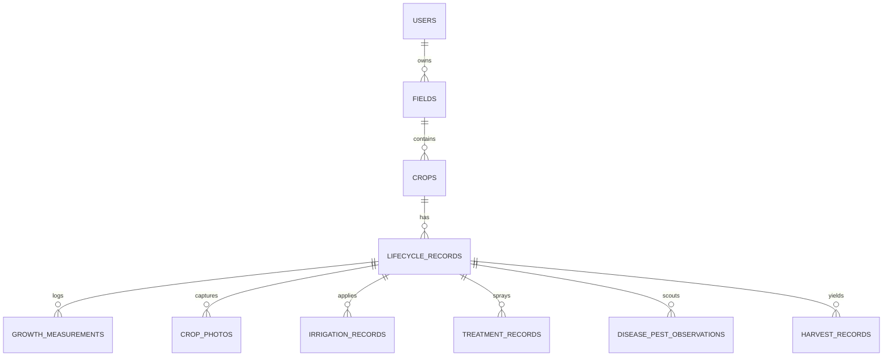

# ZyGENE - Agritech Crop Lifecycle Tracking & Phenotyping Platform

## 1. Executive Summary & Purpose

**ZyGENE** is an end-to-end Agritech Crop Lifecycle Tracking and Phenotyping Platform designed to connect on-field farming operations with scientific plant breeding and agricultural research.

### Why ZyGENE Exists
In modern agriculture, there is a disconnect between the field and the research lab:
* **For Farmers:** Farm operations (sowing, irrigation, fertilizer/chemical spraying, disease scouting, and harvest yield logging) are often tracked using paper records or disparate notes. This leads to operational friction, lost data, and an inability to trace crop history across growth cycles.
* **For Plant Breeders & Agronomists:** Evaluating trial performance of new genotypes and seed varieties requires structured, chronological, stage-by-stage phenotypic data (germination rate, growth measurements, disease susceptibility, water responsiveness, and yield per unit area across different soil types and microclimates). Without standardized field recording, breeders cannot systematically compare variety performance.

### The Solution
ZyGENE organizes farm operations into a **stage-centric lifecycle hierarchy**:
$$\text{User / Farm} \longrightarrow \text{Field} \longrightarrow \text{Crop \& Variety} \longrightarrow \text{Lifecycle Stage} \longrightarrow \begin{cases} \text{Growth Measurements} \\ \text{Photo Documentation (Camera)} \\ \text{Irrigation Logs} \\ \text{Treatment / Spray Logs} \\ \text{Disease \& Pest Observations} \\ \text{Harvest \& Yield Data} \end{cases}$$

This structure provides farmers with an intuitive operational tool while generating longitudinal phenotypic datasets for breeders to evaluate variety performance.

---

## 2. System Architecture & Tech Stack

ZyGENE is structured as a full-stack monorepo:

```
ZyGene/
├── backend/       # Node.js + Express REST API + MySQL Database
└── mobile/        # React Native (Expo SDK 54) + Expo Router
```

### Backend Architecture
* **Runtime & Framework:** Node.js + Express REST API (`server.js`).
* **Database Layer:** MySQL relational database managed via `mysql2` connection pools (`config/db.js`).
* **Authentication & Security:** Password hashing via `bcrypt` (10 salt rounds) and stateless session tokens via `jsonwebtoken` (JWT with 7-day expiration).
* **Multi-Tenant Data Isolation:** Custom authorization middleware (`middleware/authMiddleware.js`) that validates bearer tokens and verifies user ownership through field and crop relational chains.

### Mobile Architecture
* **Framework:** React Native built with **Expo SDK 54** and **Expo Router** for file-based routing.
* **State & Networking:** Axios instance with automated JWT request interceptors (`services/api.js`) and persistent storage via `@react-native-async-storage/async-storage`.
* **Hardware Integration:** Native device camera integration via `expo-camera` (`CameraView`) for live field photo capture and GPS coordinate logging.

---

## 3. Database Schema & Data Model

The platform uses a normalized relational MySQL schema ensuring data integrity and ownership verification.



### Database Tables & Fields

1. **`users`**:
   * `id` (PK, INT AUTO_INCREMENT)
   * `name` (VARCHAR), `email` (VARCHAR UNIQUE), `password` (VARCHAR hashed)
   * `role` (ENUM: `'farmer'`, `'breeder'`), `phone` (VARCHAR)
   * `created_at` (TIMESTAMP)

2. **`fields`**:
   * `id` (PK, INT AUTO_INCREMENT)
   * `user_id` (FK -> `users.id`)
   * `field_name` (VARCHAR), `location_name` (VARCHAR)
   * `area` (DECIMAL), `area_unit` (VARCHAR, e.g. `'acre'`, `'hectare'`)
   * `latitude` (DECIMAL), `longitude` (DECIMAL), `soil_type` (VARCHAR), `notes` (TEXT)
   * `created_at` (TIMESTAMP)

3. **`crops`**:
   * `id` (PK, INT AUTO_INCREMENT)
   * `field_id` (FK -> `fields.id`)
   * `crop_name` (VARCHAR), `variety` (VARCHAR)
   * `sowing_date` (DATE), `expected_harvest_date` (DATE)
   * `crop_status` (VARCHAR, e.g. `'active'`, `'harvested'`)
   * `notes` (TEXT), `created_at` (TIMESTAMP)

4. **`lifecycle_records`**:
   * `id` (PK, INT AUTO_INCREMENT)
   * `crop_id` (FK -> `crops.id`)
   * `stage` (ENUM: `'seed_sowing'`, `'germination'`, `'seedling'`, `'vegetative'`, `'flowering'`, `'fruiting'`, `'maturity'`, `'harvest'`)
   * `record_date` (DATE), `record_time` (TIME)
   * `latitude` (DECIMAL), `longitude` (DECIMAL), `notes` (TEXT)
   * `created_at` (TIMESTAMP)

5. **`growth_measurements`**:
   * `id` (PK, INT AUTO_INCREMENT)
   * `lifecycle_record_id` (FK -> `lifecycle_records.id`)
   * `measurement_type` (VARCHAR, e.g. `'Plant Height'`, `'Leaf Count'`, `'Canopy Spread'`)
   * `measurement_value` (DECIMAL), `unit` (VARCHAR, e.g. `'cm'`, `'count'`)
   * `notes` (TEXT), `created_at` (TIMESTAMP)

6. **`crop_photos`**:
   * `id` (PK, INT AUTO_INCREMENT)
   * `lifecycle_record_id` (FK -> `lifecycle_records.id`)
   * `image_url` (TEXT / URI), `caption` (VARCHAR), `captured_at` (DATETIME)
   * `created_at` (TIMESTAMP)

7. **`irrigation_records`**:
   * `id` (PK, INT AUTO_INCREMENT)
   * `lifecycle_record_id` (FK -> `lifecycle_records.id`)
   * `irrigation_date` (DATE), `water_amount` (DECIMAL), `water_unit` (VARCHAR, e.g. `'liters'`, `'inches'`)
   * `irrigation_method` (VARCHAR, e.g. `'Drip'`, `'Sprinkler'`, `'Flood'`)
   * `notes` (TEXT), `created_at` (TIMESTAMP)

8. **`treatment_records`**:
   * `id` (PK, INT AUTO_INCREMENT)
   * `lifecycle_record_id` (FK -> `lifecycle_records.id`)
   * `treatment_type` (VARCHAR, e.g. `'Fertilizer'`, `'Pesticide'`, `'Fungicide'`)
   * `product_name` (VARCHAR), `quantity` (DECIMAL), `quantity_unit` (VARCHAR, e.g. `'kg'`, `'ml'`)
   * `application_method` (VARCHAR, e.g. `'Foliar Spray'`, `'Soil Drench'`)
   * `application_date` (DATE), `notes` (TEXT), `created_at` (TIMESTAMP)

9. **`disease_pest_observations`**:
   * `id` (PK, INT AUTO_INCREMENT)
   * `lifecycle_record_id` (FK -> `lifecycle_records.id`)
   * `observation_type` (VARCHAR, e.g. `'Disease'`, `'Pest'`)
   * `name` (VARCHAR, e.g. `'Late Blight'`, `'Aphids'`), `severity` (VARCHAR, e.g. `'Low'`, `'Medium'`, `'High'`)
   * `affected_percentage` (DECIMAL), `observation_date` (DATE), `notes` (TEXT)
   * `created_at` (TIMESTAMP)

10. **`harvest_records`**:
    * `id` (PK, INT AUTO_INCREMENT)
    * `lifecycle_record_id` (FK -> `lifecycle_records.id`)
    * `harvest_date` (DATE), `total_yield` (DECIMAL), `yield_unit` (VARCHAR, e.g. `'kg'`, `'tons'`)
    * `area_harvested` (DECIMAL), `area_unit` (VARCHAR), `yield_per_area` (DECIMAL)
    * `number_of_plants` (INT), `average_weight` (DECIMAL), `quality_grade` (VARCHAR, e.g. `'Grade A'`)
    * `notes` (TEXT), `created_at` (TIMESTAMP)

---

## 4. Backend Implementation & API Catalog

All protected routes pass through `authMiddleware` which verifies the bearer token and sets `req.user`.

### Auth API (`/api/auth`)
* `POST /api/auth/register`: Validates name/email/password, checks existing accounts, hashes password with `bcrypt`, creates record.
* `POST /api/auth/login`: Verifies email and password hash, generates and returns signed JWT token and user profile.

### Fields API (`/api/fields`)
* `POST /api/fields`: Creates a farm field associated with `req.user.id`.
* `GET /api/fields`: Retrieves all fields owned by the authenticated user.
* `GET /api/fields/:id`: Retrieves single field record verifying user ownership.
* `PUT /api/fields/:id`: Updates field attributes (name, area, coordinates, soil type).
* `DELETE /api/fields/:id`: Deletes field record if owned by authenticated user.

### Crops API (`/api/crops`)
* `POST /api/crops`: Registers a new crop under a user-owned field.
* `GET /api/crops`: Fetches all crops owned by the user (joins `crops` with `fields`).
* `GET /api/crops/:id`: Fetches detailed crop information with field metadata.
* `PUT /api/crops/:id`: Updates crop variety, dates, status, or notes.
* `DELETE /api/crops/:id`: Deletes crop record ensuring field ownership.

### Lifecycle API (`/api/lifecycle`)
* `POST /api/lifecycle`: Creates a new lifecycle stage record (e.g. `vegetative`, `flowering`) with date, time, coordinates, and notes.
* `GET /api/lifecycle/:cropId`: Retrieves the chronological lifecycle history for a crop.

### Lifecycle Sub-Module APIs
* **Measurements (`/api/measurements`):**
  * `POST /api/measurements`: Logs phenotypic metric for a stage.
  * `GET /api/measurements/:lifecycleRecordId`: Retrieves all measurements logged under a stage.
* **Photos (`/api/photos`):**
  * `POST /api/photos`: Saves photo URL/URI, timestamp, and caption.
  * `GET /api/photos/:lifecycleRecordId`: Retrieves all photo records for a stage.
* **Irrigation (`/api/irrigation`):**
  * `POST /api/irrigation`: Logs watering amount, method, and date.
  * `GET /api/irrigation/:lifecycleRecordId`: Retrieves all irrigation events for a stage.
* **Treatments (`/api/treatments`):**
  * `POST /api/treatments`: Logs fertilizer/chemical applications and dosage.
  * `GET /api/treatments/:lifecycleRecordId`: Retrieves all treatment logs for a stage.
* **Disease & Pests (`/api/disease-pests`):**
  * `POST /api/disease-pests`: Records pest/disease observations, severity, and infection rate.
  * `GET /api/disease-pests/:lifecycleRecordId`: Retrieves disease observations for a stage.
* **Harvest (`/api/harvest`):**
  * `POST /api/harvest`: Records final harvested yield, yield per area, quality grade, and fruit weight.
  * `GET /api/harvest/:lifecycleRecordId`: Retrieves harvest metrics for a stage.

### Breeder Analytics Engine (`/api/breeder`)
Calculates aggregated trial metrics across varieties and locations using optimized SQL queries:
1. `GET /api/breeder/overview`: Aggregates total crops, distinct varieties, total harvests, and overall average yield.
2. `GET /api/breeder/variety-comparison`: Yield benchmarking and yield-per-area across all tested varieties.
3. `GET /api/breeder/growth-duration`: Computes days from sowing to harvest (`DATEDIFF(harvest_date, sowing_date)`) showing min, max, and average growth cycles by variety.
4. `GET /api/breeder/disease-occurrence`: Calculates percentage of crops affected by pests/diseases per variety.
5. `GET /api/breeder/location-performance`: Cross-tabulates variety performance by geographical field location.
6. `GET /api/breeder/stage-performance`: Aggregates stage-by-stage phenotypic growth metrics (e.g. average height) per variety.
7. `GET /api/breeder/top-varieties`: Calculates a composite ranking score for each variety based on yield performance penalized by disease susceptibility.

---

## 5. Mobile Application Implementation

The mobile app is written in React Native using Expo Router for declarative navigation.

### Screen & Navigation Flow
```
mobile/app/
├── index.jsx                                            # Initial redirect
├── login.jsx                                            # User login & token storage
├── register.jsx                                         # New user registration
├── farmer/
│   ├── dashboard.jsx                                    # Stats overview, field & crop listing
│   ├── create-field.jsx                                 # Field registration form
│   ├── create-crop.jsx                                  # Crop setup form
│   └── crop-details/
│       ├── [id].jsx                                     # Crop profile & lifecycle entry
│       └── [id]/
│           ├── lifecycle.jsx                            # 8-stage lifecycle timeline hub
│           ├── measurements/[recordId].jsx              # Growth metrics recording
│           ├── photos/[recordId].jsx                    # Camera capture & photo gallery
│           ├── irrigation/[recordId].jsx                # Irrigation event logging
│           ├── treatments/[recordId].jsx                # Chemical/organic spray logging
│           ├── disease-pest/[recordId].jsx              # Scouting & severity logging
│           └── harvest/[recordId].jsx                   # Harvest yield & grading logging
└── breeder/
    └── dashboard.jsx                                    # Breeder analytics dashboard
```

### Key Mobile Capabilities
* **Automatic JWT Interceptor:** Axios automatically attaches stored JWT bearer tokens to every outgoing HTTP request and redirects to login on authorization failure.
* **Integrated Field Camera (`expo-camera`):** `photos/[recordId].jsx` allows farmers to open a live camera viewfinder in the field, capture pictures of plants/pests, preview the image, attach captions, and save it directly to the lifecycle stage.
* **Input Validation & Date Handling:** Standardized `YYYY-MM-DD` date inputs and numeric conversions ensure cross-platform compatibility across iOS and Android.

---

## 6. Key Design Decisions & Technical Rationale

1. **Stage-Centric Data Architecture:**
   * *Rationale:* Farming operations and plant phenotyping are time- and stage-dependent. Associating inputs and observations with a specific phenological stage (e.g., flowering vs. vegetative) allows agronomists to determine the exact relationship between management practices and final yield outcomes.

2. **Relational Multi-Tenant Security:**
   * *Rationale:* Every backend query checks permissions by joining up the entity tree (`sub_record -> lifecycle_records -> crops -> fields -> user_id = req.user.id`). This prevents unauthorized access between farm accounts.

3. **Database-Level Aggregation for Analytics:**
   * *Rationale:* Analytics calculations (such as growth duration, disease percentage, and yield ranking) are performed directly in MySQL queries using `AVG()`, `COUNT(DISTINCT)`, `DATEDIFF()`, and `GROUP BY`. This optimizes response times and reduces mobile device memory load.

---

## 7. Current Project Status & Roadmap

| Component | Status | Description |
| :--- | :--- | :--- |
| **Backend REST APIs** | ✅ Complete | Full CRUD for Auth, Fields, Crops, Lifecycle, and all 6 Sub-modules. |
| **Breeder Analytics Engine** | ✅ Complete | 7 analytical endpoints aggregating variety performance. |
| **Database Schema** | ✅ Complete | 10 normalized MySQL tables with foreign key constraints. |
| **Farmer Mobile Workflows** | ✅ Complete | Complete UI for field setup, crop management, lifecycle timeline, camera capture, and all 6 logging screens. |
| **Breeder Mobile Dashboard** | 🚧 Next Step | Connect `mobile/app/breeder/dashboard.jsx` to the breeder analytical APIs with visualization charts. |
| **Offline Sync Support** | 🚧 Planned | Local SQLite caching with background synchronization for low-connectivity field areas. |
| **Cloud Photo Storage** | 🚧 Planned | S3 / Cloudflare R2 object storage integration for photo uploads. |
