<p align="center">
  
</p>

<h1 align="center">ZyGENE</h1>

<p align="center">
  <strong>Intelligent Agritech Crop Lifecycle Tracking & Plant Breeder Phenotyping Platform</strong>
</p>

<p align="center">
  
  
  
  
  
  
</p>

---

## 📖 Table of Contents

- [Overview & Purpose](#-overview--purpose)
- [Key Features](#-key-features)
  - [🚜 For Farmers](#-for-farmers)
  - [🔬 For Plant Breeders & Researchers](#-for-plant-breeders--researchers)
- [System Architecture](#-system-architecture)
- [Database Schema & Data Model](#-database-schema--data-model)
- [REST API Reference](#-rest-api-reference)
- [Getting Started](#-getting-started)
  - [1. Prerequisites](#1-prerequisites)
  - [2. Database Initialization](#2-database-initialization)
  - [3. Backend Setup](#3-backend-setup)
  - [4. Mobile App Setup](#4-mobile-app-setup)
- [Testing & Verification](#-testing--verification)
- [Project Directory Structure](#-project-directory-structure)
- [License](#-license)

---

## 🌟 Overview & Purpose

**ZyGENE** bridges the long-standing disconnect between on-field farming operations and scientific plant breeding research:

* **The Problem in the Field:** Farm operations—seed sowing, irrigation schedules, fertilizer and chemical sprays, disease scouting, and harvest logging—are typically fragmented across paper notebooks and disparate messaging apps. This causes severe operational friction and loss of longitudinal crop history.
* **The Problem in the Lab:** Plant breeders and agronomists evaluating trial performance of candidate genotypes lack standardized, chronological, stage-by-stage phenotypic data (germination rate, growth measurements, disease susceptibility, water responsiveness, and yield per unit area across microclimates and soil profiles).
* **The ZyGENE Solution:** ZyGENE implements a unified **stage-centric lifecycle hierarchy**:

```
User / Farm
 └── Field (Coordinates, Soil Type, Area)
      └── Crop & Variety (Sowing Date, Status)
           └── Lifecycle Stage (Chronological Growth Timeline)
                ├── Quantitative Growth Measurements (Height, Leaves, Canopy)
                ├── Photographic Documentation (Native Camera + Geolocation)
                ├── Irrigation Logs (Method, Volume, Date)
                ├── Chemical & Fertilizer Treatments (Dosage, Active Ingredient)
                ├── Pest & Disease Observations (Severity, Symptoms, Affected %)
                └── Harvest Production (Yield, Yield/Area, Quality Grading)
```

Farmers gain an intuitive mobile assistant for daily field tasks, while breeders gain an automated, structured data pipeline powering deep comparative analytics.

---

## 🚀 Key Features

### 🚜 For Farmers

* **Field & Boundary Management:** Register agricultural fields with GPS coordinates, total area (acres/hectares), soil classification (alluvial, black, red, clay, loam), and location identifiers.
* **Crop Lifecycle Timeline:** Track crops from planting to harvest through 8 standardized growth stages:
  `seed_sowing` $\rightarrow$ `germination` $\rightarrow$ `seedling` $\rightarrow$ `vegetative` $\rightarrow$ `flowering` $\rightarrow$ `fruiting` $\rightarrow$ `maturity` $\rightarrow$ `harvest`.
* **Sub-Module Record Logging:**
  * 📏 **Growth Measurements:** Record plant height, stem caliper, canopy spread, and leaf counts.
  * 📷 **Photo Documentation:** Capture on-field photos directly through device cameras with automatic GPS metadata and timestamps.
  * 💧 **Irrigation Tracking:** Track water application methods (drip, sprinkler, flood, furrow) and irrigation durations.
  * 🧪 **Treatment Logs:** Log pesticide, fungicide, herbicide, and fertilizer applications with chemical names and dosage rates.
  * 🐛 **Scouting & Disease Tracking:** Record pest encounters and symptoms with structured severity ratings (`low`, `moderate`, `high`, `severe`) and affected crop percentage.
  * ⚖️ **Harvest Production:** Log harvest batches, total yield, automatic yield-per-area calculation, and commercial quality grading (`Grade A`, `Grade B`, `Grade C`, `Commercial`, `Export`).
* **Search, Filter & Sort:** Filter historical records by date, severity, measurement type, or keyword search.

### 🔬 For Plant Breeders & Researchers

* **Breeding Programs:** Create multi-year breeding initiatives with designated objectives, target crops, and operational statuses (`planned`, `active`, `completed`).
* **Crosses & Pedigrees:** Record parental crosses (`parent_1` $\times$ `parent_2`), filial generations ($F_1, F_2, F_3$), cross codes, pollination dates, and success evaluations.
* **Multi-Environment Varietal Trials:** Conduct replicated variety trials across distinct agro-climatic zones, seasons, and planting dates.
* **Phenotypic Scoring & Observations:** Record quantitative trait evaluations, resistance ratings (1–10 scales), and botanical observations for candidate varieties.
* **7-Endpoint Breeder Analytics Engine:**
  1. **Dashboard Overview:** Real-time platform KPI metrics (active programs, field trials, varieties evaluated, yield averages).
  2. **Head-to-Head Variety Comparison:** Direct multi-metric comparison between candidate varieties and commercial controls.
  3. **Growth Duration Analysis:** Stage-by-stage duration calculations using SQL date differences.
  4. **Disease Occurrence & Susceptibility:** Frequency of pest and disease outbreaks broken down by variety and growth stage.
  5. **Geographical Performance:** Environmental responsiveness and yield variation across field locations and soil types.
  6. **Stage-by-Stage Phenotypic Trait Expression:** Quantitative progression of vegetative and reproductive traits over time.
  7. **Composite Variety Leaderboard:** Multi-trait weighted composite scoring ranking top-performing cultivars.

---

## 🏗️ System Architecture

ZyGENE is engineered as a full-stack monorepo:

```
ZyGene/
├── backend/            # Node.js + Express 5 REST API + PostgreSQL / MySQL
│   ├── config/         # PostgreSQL connection pool with MySQL compatibility layer
│   ├── controllers/    # Domain-driven controller business logic
│   ├── middleware/     # JWT authentication and user ownership verification
│   ├── routes/         # Express endpoint route declarations
│   └── scripts/        # Automated test suites & migration utilities
└── mobile/             # React Native (Expo SDK 57) + Expo Router
    ├── app/            # File-based routing (Index, Auth, Farmer, Breeder)
    ├── components/     # Design system components, modals, inputs, and drawers
    ├── constants/      # Design tokens (Colors, Typography, Shadows, Spacing)
    └── services/       # Axios API client with automated JWT request interceptor
```

### Backend Architecture
* **Runtime:** Node.js + Express 5 REST API.
* **Database Layer:** Managed PostgreSQL connection pool (`pg`) with a MySQL-compatible translation layer (`convertPlaceholders` and `executeQuery`), enabling zero-downtime execution of queries with parameterized `$1, $2` and `?` syntaxes.
* **Security & Auth:** Password hashing via `bcrypt` (10 salt rounds) and stateless session tokens via `jsonwebtoken` (JWT, 7-day expiry).
* **Multi-Tenant Ownership Verification:** Middleware verifies that requesting users own the specified field, crop, or breeding record before granting write or read access.

### Mobile Architecture
* **Framework:** React Native powered by **Expo SDK 57** and **Expo Router** for declarative file-based screen routing.
* **Device Integration:** Live hardware camera capture via `expo-camera` (`CameraView`) and geolocation tracking.
* **Persistence & Network:** Axios client configured with JWT interceptors, auto-attaching bearer tokens stored securely via `@react-native-async-storage/async-storage`.

---

## 🗄️ Database Schema & Data Model

ZyGENE uses a normalized relational schema with 15 tables enforcing foreign key constraints and cascade actions:

```mermaid
erDiagram
    USERS ||--o{ FIELDS : owns
    FIELDS ||--o{ CROPS : contains
    CROPS ||--o{ LIFECYCLE_RECORDS : has
    LIFECYCLE_RECORDS ||--o{ GROWTH_MEASUREMENTS : logs
    LIFECYCLE_RECORDS ||--o{ CROP_PHOTOS : captures
    LIFECYCLE_RECORDS ||--o{ IRRIGATION_RECORDS : applies
    LIFECYCLE_RECORDS ||--o{ TREATMENT_RECORDS : sprays
    LIFECYCLE_RECORDS ||--o{ DISEASE_PEST_OBSERVATIONS : scouts
    LIFECYCLE_RECORDS ||--o{ HARVEST_RECORDS : yields

    USERS ||--o| BREEDER_PROFILES : has
    USERS ||--o{ BREEDING_PROGRAMS : manages
    BREEDING_PROGRAMS ||--o{ BREEDING_CROSSES : contains
    BREEDING_PROGRAMS ||--o{ BREEDING_TRIALS : conducts
    BREEDING_CROSSES ||--o{ BREEDING_TRIALS : tests
    BREEDING_TRIALS ||--o{ TRIAL_OBSERVATIONS : records
```



### Table Breakdown

| Table Name | Primary Responsibility |
|---|---|
| `users` | User credentials, roles (`farmer`, `breeder`, `admin`), phone, timestamps |
| `fields` | Farm plots, geolocation (`latitude`, `longitude`), area, soil types |
| `crops` | Sown crops, variety designations, sowing dates, status |
| `lifecycle_records` | Stage transitions (`seed_sowing` through `harvest`), stage dates, coordinates |
| `growth_measurements` | Plant height, leaf counts, canopy metrics, custom units |
| `crop_photos` | Photo metadata, base64 / cloud storage URIs, timestamps |
| `irrigation_records` | Irrigation method, water volume, duration, application date |
| `treatment_records` | Fertilizers, pesticides, active ingredients, dosage rates |
| `disease_pest_observations`| Pests/diseases, symptom descriptions, severity rating, affected % |
| `harvest_records` | Total yield, area harvested, yield/area ratio, commercial quality grade |
| `breeder_profiles` | Organization, specialization, research institute, credentials |
| `breeding_programs` | Program objectives, focus crops, status (`planned`, `active`, `completed`) |
| `breeding_crosses` | Pedigree crosses (`parent_1` $\times$ `parent_2`), filial generation ($F_1$–$F_6$) |
| `breeding_trials` | Multi-location variety trials, season, start/end dates |
| `trial_observations` | Quantitative phenotyping traits, rating scores, observation dates |

---

## 📡 REST API Reference

All protected endpoints require an `Authorization: Bearer <token>` header.

### Authentication & Profile (`/api/auth`)
| Method | Endpoint | Description |
|---|---|---|
| `POST` | `/api/auth/register` | Register farmer or breeder (auto-creates breeder profile) |
| `POST` | `/api/auth/login` | Authenticate user credentials and return JWT bearer token |
| `GET` | `/api/auth/me` | Fetch authenticated user profile and role details |

### Field Management (`/api/fields`)
| Method | Endpoint | Description |
|---|---|---|
| `GET` | `/api/fields` | List all fields owned by the authenticated user |
| `POST` | `/api/fields` | Register a new agricultural field |
| `GET` | `/api/fields/:id` | Get details and crop history for a specific field |
| `PUT` | `/api/fields/:id` | Update field properties, boundaries, or soil type |
| `DELETE` | `/api/fields/:id` | Delete field (cascades to associated crops) |

### Crop Management (`/api/crops`)
| Method | Endpoint | Description |
|---|---|---|
| `GET` | `/api/crops` | List user crops joined with field attributes |
| `POST` | `/api/crops` | Register a new crop planting linked to a field |
| `GET` | `/api/crops/:id` | Retrieve comprehensive crop profile and status |
| `PUT` | `/api/crops/:id` | Update crop status, expected harvest date, notes |
| `DELETE` | `/api/crops/:id` | Delete crop and associated lifecycle records |

### Lifecycle & Sub-Module Records (`/api/*`)
| Method | Endpoint | Description |
|---|---|---|
| `GET` / `POST` | `/api/lifecycle/:cropId` | List or create chronological stage records for a crop |
| `GET` / `POST` | `/api/measurements/:recordId` | List or log growth measurements for a stage |
| `GET` / `POST` | `/api/photos/:recordId` | List or record photo metadata for a stage |
| `GET` / `POST` | `/api/irrigation/:recordId` | List or log irrigation events for a stage |
| `GET` / `POST` | `/api/treatments/:recordId` | List or log chemical/fertilizer applications |
| `GET` / `POST` | `/api/disease-pests/:recordId`| List or log disease/pest scouting observations |
| `GET` / `POST` | `/api/harvest/:recordId` | List or log harvest yields and quality grading |

### Breeder Intelligence & Analytics (`/api/breeder`)
| Method | Endpoint | Description |
|---|---|---|
| `GET` / `PUT` | `/api/breeder/profile` | View or update breeder profile and institute info |
| `GET` / `POST` | `/api/breeder/programs` | List or create breeding programs |
| `GET` / `POST` | `/api/breeder/crosses` | List or create pedigree crosses |
| `GET` / `POST` | `/api/breeder/trials` | List or create multi-location breeding trials |
| `GET` / `POST` | `/api/breeder/observations` | List or record trial phenotypic observations |
| `GET` | `/api/breeder/analytics/overview` | Platform-wide research KPI metrics |
| `GET` | `/api/breeder/analytics/variety-comparison` | Head-to-head varietal trait performance |
| `GET` | `/api/breeder/analytics/growth-duration` | Stage duration analysis across varieties |
| `GET` | `/api/breeder/analytics/disease-occurrence`| Disease susceptibility & frequency analysis |
| `GET` | `/api/breeder/analytics/location-performance` | Environmental & yield responsiveness by site |
| `GET` | `/api/breeder/analytics/phenotypic-performance` | Longitudinal trait expression by growth stage |
| `GET` | `/api/breeder/analytics/top-varieties` | Weighted composite score leaderboard |

---

## 🛠️ Getting Started

### 1. Prerequisites

- **Node.js**: v18.0.0 or higher
- **npm**: v9.0.0 or higher
- **PostgreSQL**: v14+ (or MySQL v8.0+)
- **Expo Go App** (optional, for physical iOS/Android testing)

---

### 2. Database Initialization

1. Open **pgAdmin 4** (or `psql`) connected to your PostgreSQL server.
2. Create a database named `zygene`:
   ```sql
   CREATE DATABASE zygene;
   ```
3. Open `backend/zygene_pgadmin_setup.sql` in the Query Tool (or run via command line):
   ```bash
   psql -U postgres -d zygene -f backend/zygene_pgadmin_setup.sql
   ```
4. All 15 relational tables, cascade constraints, performance indexes, and seed datasets will be created automatically.

---

### 3. Backend Setup

```bash
cd backend
npm install
```

Create a `.env` file inside `backend/`:
```env
PORT=4000
DB_HOST=localhost
DB_USER=postgres
DB_PASSWORD=your_postgres_password
DB_NAME=zygene
DB_PORT=5432
JWT_SECRET=your_super_secret_jwt_key_here
```

Start the backend server:
```bash
# Start development server with nodemon
npm run dev

# Or start standard production server
npm start
```
The server will start on `http://localhost:4000`. Test the health check endpoint:
```bash
curl http://localhost:4000/api/health
# Response: {"message":"ZyGene API is running"}
```

---

### 4. Mobile App Setup

```bash
cd mobile
npm install
```

Start the Expo development server:
```bash
npx expo start
```

* Press `w` to open the app in your **web browser**.
* Press `a` to open in an **Android Emulator**.
* Press `i` to open in an **iOS Simulator**.
* Scan the QR code using the **Expo Go** app on your physical device.

---

## 🧪 Testing & Verification

ZyGENE includes comprehensive automated test suites to verify backend API contracts, database operations, and frontend code quality:

### Run Backend Feature & Analytics Tests
```bash
cd backend
node scripts/test_all_features.js
```
Runs **53 automated integration tests** validating:
* Health check
* Farmer Field & Crop operations
* Lifecycle timeline & 6 sub-module record logging
* Breeder Programs, Crosses, Trials, & Observations
* All 7 complex SQL Breeder Analytics Engine endpoints

### Run Authentication Tests
```bash
cd backend
node scripts/test_auth.js
```
Runs **7 isolated authentication tests** validating registration, duplicate email rejection (409 Conflict), automatic breeder profile creation, password verification, 401 Unauthorized handling, and protected profile access.

### Run Mobile Code Quality & Lint Checks
```bash
cd mobile
npm run lint
```
Executes ESLint validation across all Expo Router screens and shared UI components (0 errors).

---

## 📁 Project Directory Structure

```text
ZyGene/
├── .gitignore                          # Root Git ignore rules
├── PROJECT_OVERVIEW.md                 # Detailed architectural documentation
├── README.md                           # Master project documentation
├── zygene_pgadmin_setup.sql            # Master PostgreSQL schema & seed migration
├── backend/
│   ├── config/
│   │   └── db.js                       # PostgreSQL pool + MySQL translation layer
│   ├── controllers/
│   │   ├── authController.js           # Registration, login, profile resolution
│   │   ├── breederController.js        # Analytics engine & breeder operations
│   │   ├── breederProfileController.js # Breeder credentials & institute info
│   │   ├── breedingCrossController.js  # Pedigree crosses & generation tracking
│   │   ├── breedingProgramController.js# Breeding program management
│   │   ├── breedingTrialController.js  # Multi-environment trial tracking
│   │   ├── cropController.js           # Crop planting & management
│   │   ├── diseasePestController.js    # Scouting & severity tracking
│   │   ├── fieldController.js          # Field plots & GPS boundaries
│   │   ├── harvestController.js        # Harvest batch & yield calculations
│   │   ├── irrigationController.js     # Water tracking & methods
│   │   ├── lifecycleController.js      # Chronological stage progression
│   │   ├── measurementController.js    # Quantitative growth measurements
│   │   ├── photoController.js          # Photo documentation metadata
│   │   ├── treatmentController.js      # Spray & fertilizer logs
│   │   └── trialObservationController.js# Trial phenotyping observations
│   ├── middleware/
│   │   └── authMiddleware.js           # JWT verification & multi-tenant isolation
│   ├── routes/                         # Express REST endpoint declarations
│   ├── scripts/                        # Automated feature & auth test suites
│   ├── server.js                       # Express app entry point
│   └── package.json
└── mobile/
    ├── app/                            # Expo Router file-based screens
    │   ├── index.jsx                   # Welcome / Hero landing screen
    │   ├── login.jsx                   # User authentication
    │   ├── register.jsx                # Role-based onboarding (Farmer / Breeder)
    │   ├── farmer/                     # Farmer workflows & screens
    │   │   ├── dashboard.jsx           # Farmer operational hub
    │   │   ├── fields.jsx              # Field listing & management
    │   │   ├── create-field.jsx        # Field creation form
    │   │   ├── field-details/[id].jsx  # Detailed field inspect & crops
    │   │   ├── crops.jsx               # Crop portfolio
    │   │   ├── create-crop.jsx         # Planting registration
    │   │   └── crop-details/[id]/      # Lifecycle timeline & 6 sub-module screens
    │   └── breeder/                    # Breeder workflows & screens
    │       ├── dashboard.jsx           # Breeder research hub
    │       ├── programs.jsx            # Multi-year breeding programs
    │       ├── crosses.jsx             # Pedigree cross register
    │       ├── trials.jsx              # Multi-site variety trials
    │       └── analytics.jsx           # 7-endpoint graphical analytics suite
    ├── components/                     # Reusable UI & design system elements
    │   ├── ui/                         # Buttons, inputs, search bars, modals
    │   └── farmer/                     # Quick-add forms, selectors, badges
    ├── constants/                      # Design tokens (theme, colors, typography)
    ├── services/                       # Axios client & JWT interceptors
    ├── app.json                        # Expo app configuration
    ├── eas.json                        # EAS build profiles
    └── package.json
```

---

## 📄 License

This project is licensed under the [ISC License](LICENSE).